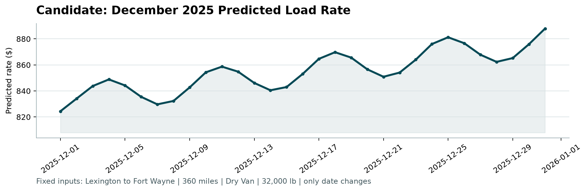

# Freight Rate Prediction — Validation Report

## Objective

Predict `posted_rate` for 12,000 held-out loads (Nov–Dec 2025) and produce a fixed-lane December 2025 rate chart (Lexington → Fort Wayne, 360 miles, Dry Van, 32,000 lb).

## Data split approach

Development data in `data/train-test.csv` covers **2025-01-01 through 2025-10-31** (48,000 loads). Final evaluation loads in `data/validation.csv` cover **2025-11-01 through 2025-12-31**.

| Split | Dates | Rows | Use |
|---|---|---|---|
| Fit | Jan–Aug 2025 | 38,477 | Model fitting / contamination stats |
| Holdout | Sep–Oct 2025 | 9,523 | Model selection & metrics |
| Final train | Jan–Oct 2025 (cleaned) | 47,323 | Refit before submission predictions |

A random shuffle split would leak near-term market conditions into the test fold. The Sep–Oct holdout keeps the same **time-forward** structure as the real Nov–Dec scoring window.

## Cleaning / data-side regularization

- `weight`: absolute value (sign errors), then median fill
- `market_index`: same-date median fill (row vs date-mean correlation ≈ 0.99)
- **Train-only RPM contamination filter:** for each equipment × distance quantile bin, drop rows whose rate-per-mile is outside **0.5–1.8×** the bin’s typical median RPM (~1.4% of rows). Holdout / validation labels are never filtered for scoring — only training labels are cleaned so the model does not fit corrupt `$` targets.
- Unseen cities map via city coordinate lookup from training; `quote_signal` on the December chart uses the Dry Van training median

## Model: two-part (Ridge level + LightGBM residual)

Both parts predict **log(rate per mile)**. Final price:

`price = distance × exp(part1 + part2)`

1. **Part 1 — Ridge** on market/level features: `log(distance)`, equipment flags, weight, `market_index`, months-since-start trend, quarter-end ramp. Linear time features can extrapolate Nov–Dec market drift.
2. **Part 2 — LightGBM** on residual log-RPM using route/load detail only (**no calendar features**): distance, weight, equipment, lat/lon, deltas, `quote_signal`. Trees correct local structure without overfitting short-horizon date noise.

Compared against cleaned-train GBDT baselines (same Sep–Oct holdout):

| Model | Target | Full holdout MAE | MedAE | MAPE |
|---|---|---:|---:|---:|
| LightGBM | absolute $ | 116.03 | 37.24 | 4.9% |
| XGBoost | absolute $ | 112.20 | 34.14 | 4.7% |
| XGBoost RPM | $/mile × miles | 109.17 | 35.26 | 4.7% |
| HistGradientBoosting | absolute $ | 119.02 | 39.59 | 5.0% |
| **Two-part Ridge + LGBM** | **log-RPM → $** | **89.05** | **22.67** | **4.0%** |

On holdout rows that pass the same contamination rule (diagnostic only):

| Slice | MAE | MedAE | MAPE |
|---|---:|---:|---:|
| Full Sep–Oct | 89.05 | 22.67 | 4.0% |
| Clean Sep–Oct (~98.5%) | 32.96 | 22.24 | 1.4% |

Full-holdout MAE is dominated by the ~1.5% contaminated labels; the two-part model + train-only cleaning is what moves full MAE under 100 (≈89 vs ≈109 for the best single GBDT).

Final submission model: **two-part** refit on cleaned Jan–Oct.

## Final predictions

1. Fit contamination model on Jan–Oct, drop contaminated training rows, fit two-part model
2. Score `data/validation.csv` → `outputs/validation_predictions.csv` (12,000 rows)
3. December chart: city coords from training map, `market_index` by date from train+validation panels, Dry Van median `quote_signal`, score with two-part → `outputs/december_chart_inputs.csv`

Predicted December rates for the fixed lane fall roughly in the **$824–$888** range.

## Scorer output

```bash
python score.py \
  --predictions outputs/validation_predictions.csv \
  --december-predictions outputs/december_chart_inputs.csv \
  --output-dir outputs
```

Produces `outputs/candidate_december.png`.



## How to reproduce

```bash
python3 -m venv .venv
source .venv/bin/activate
python -m pip install -r requirements.txt
python train_predict.py --model two_part
python score.py \
  --predictions outputs/validation_predictions.csv \
  --december-predictions outputs/december_chart_inputs.csv \
  --output-dir outputs
```
